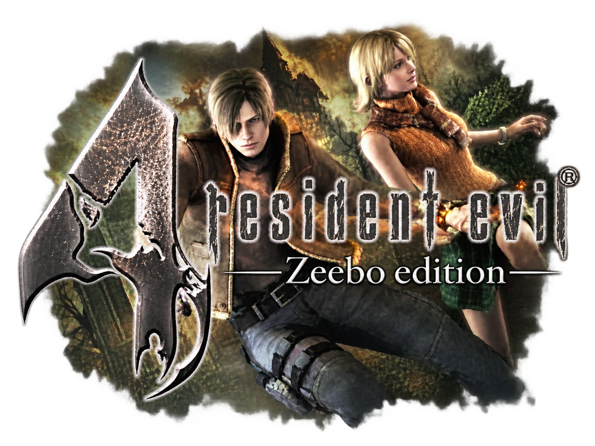
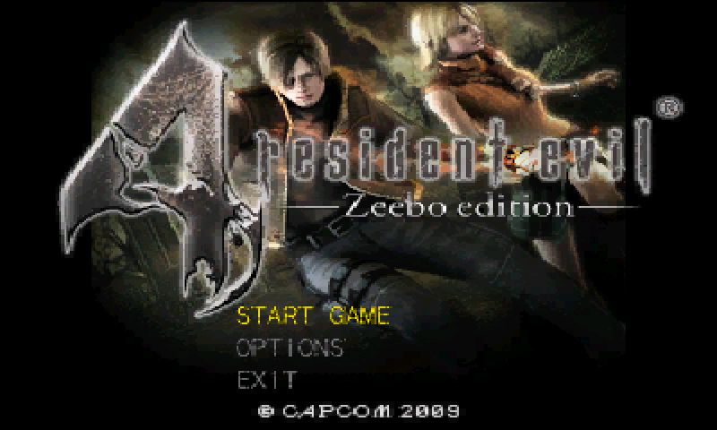
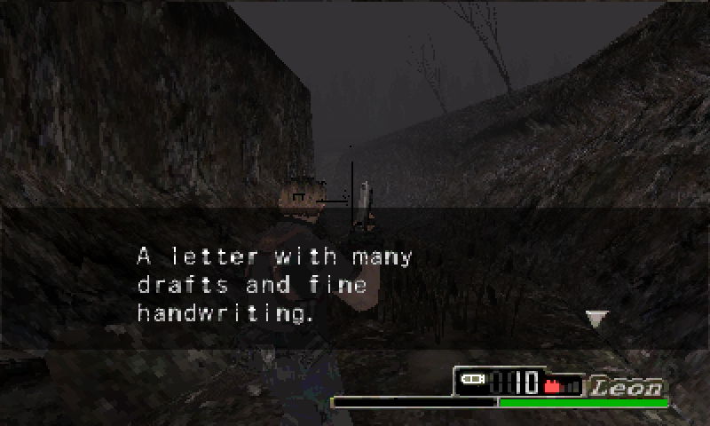

<p align="center">
  
</p>

---

A port of the Zeebo version of Resident Evil 4 to the Nintendo 3DS. It runs the game's original code, now in English.

> [!IMPORTANT]
> **No game files are included here or in the release.** You need your own copy of the Zeebo
> version of the game.

<p align="center">
  
  
</p>

## Download & Install

Grab `re4z.cia` from the [Releases](../../releases) page and install it with FBI. You need a 3DS
with Luma3DS.

Then the game files. From your Zeebo copy you only need the `mod/276675/` folder: `bio4_brew.mod`
and the 14 `.h2z` files. Make a folder called `re4z` at the root of your SD card and copy them in,
like this:

```
SD card
└── re4z/
    ├── bio4_brew.mod
    ├── common.h2z
    ├── 3d_base.h2z
    ├── 3d_stg01.h2z
    ├── 3d_stg02_00.h2z
    ├── 3d_stg03_00.h2z
    ├── 3d_stg04_00.h2z
    ├── 3d_stg05_00.h2z
    ├── 3d_stg06_00.h2z
    ├── 3d_stg07_00.h2z
    ├── 3d_stg08_00.h2z
    ├── 3d_stg09_00.h2z
    ├── 3d_stg10_00.h2z
    ├── 3d_stg11_00.h2z
    ├── 3d_stg12_00.h2z
    └── bgm.sf2          (optional, for music, see below)
```

Keep the names exactly as they are. You don't need the `.sig` file or the `mif` folder, and your
files are only read, never modified.

For sound you also need a DSP dump at `sdmc:/3ds/dspfirm.cdc`. If you don't have one, run DSP1
once. Without it the game still runs, just silent.

Then launch it from the HOME menu. Saves go to `sdmc:/re4z/udata/` and the log is at
`sdmc:/re4z/log_cia.txt`.

### Music (optional)

The game's music is MIDI, so it needs a soundfont. [GeneralUser GS](https://www.schristiancollins.com)
works well (any General MIDI `.sf2` does), but it's huge, so shrink it first with the script in
this repo:

```bash
python3 re/sf2shrink.py GeneralUser-GS.sf2 bgm.sf2 --rate 22050 --gm
```

That gives you a `bgm.sf2` of about 20 MB. Put it in `sdmc:/re4z/`. Without it you still get all
the sound effects, just no music.

## Controls

| 3DS | Zeebo pad |
|---|---|
| A | button 1 (confirm) |
| B | button 2 (back) |
| X / Y | buttons 4 / 3 |
| L / R | shoulders |
| ZL / ZR | lower shoulders (New 3DS) |
| Start | menu |
| D-Pad | d-pad |
| Circle Pad | left stick |
| C-Stick, or drag on the touch screen | right stick |

**X** opens the Status screen on the bottom screen. **Select + Start** switches between widescreen
and 4:3. Hold **L** while booting to skip the music (**R** turns off all audio).
**L + R + Select + Start** quits, same as closing from the HOME menu.

There are also a few debug keys, all **L + R** plus a face button (those buttons don't reach the
game while L + R are held):

* **L + R + B:** swaps the bottom screen to a debug console and back.
* **L + R + Y:** writes every draw call of the next frame to `log_cia.txt`.
* **L + R + A:** records 20 seconds of the music to `bgm_capture.raw`.
* **L + R + X:** cycles some GPU settings, for bugs that only show up on real hardware.

If the game freezes for more than 1.5 seconds, a watchdog writes where it got stuck to the bottom
screen and the log.

## About the translation

The Zeebo version only came out in Portuguese. All of the game's text is stored in two archives,
`common.h2z` and `3d_base.h2z`, and when the port loads them it swaps the Portuguese for English in
memory. Your files stay untouched and there's nothing extra to copy. It covers items, files,
mission and story text, the action prompts, menus, the merchant, options and results.

The English is in `re/lang/en.txt`. It was translated from the Portuguese, mostly by an AI (see
[AI Assistance](#ai-assistance)). The repo has none of the original text, only the English and the
position of each line it replaces, plus a check per line: if your copy is somehow different, a
line that doesn't match is just left alone.

The blue-skinned villagers are fixed too. The Zeebo version has the red and blue colors swapped on
their skin, so the port swaps them back when those textures load.

### Why some stuff is still in Portuguese

A few words aren't text at all, they're painted right into the game's images:

* the bonus and ranking banners in mercenary mode ("Inimigo Derrotado!", "1o lugar no RANKING!")
* the upgrade labels in the shop and the MERCENÁRIO / NARRATIVA buttons
* "Carregando jogo..." on loading screens and the case size tags on the item icons
* the ending images

Those are textures inside the game files. Translating them would mean editing Capcom's artwork and
shipping it with the port, and that's redistributing copyrighted game assets, which this project
won't do. So every image, model and sound from the game was left as it is, and nothing from the
game is included in this repo or the release. Sorry about the few Portuguese words!

## Known issues

* The music has no reverb or chorus yet (the songs ask for it, the synth ignores it).
* Only the first mipmap level of textures is used.
* Polygon offset is a fixed value and might need tuning.
* The button names in the English text (A, B, X, Y) follow the 3DS layout. X for Status is tested
  on real hardware, the rest still need checking. If one is wrong, it's a one-line fix in
  `BUTTONS` in `re/lang.py`.

## AI Assistance

Parts of the code were written or improved with the assistance of AI (Claude, by Anthropic). That
includes a good part of the port itself, the tools in `re/`, and above all the English translation
of all the game's text, which is a lot of text. All AI-assisted code was reviewed, tested, and
manually validated, with the overall implementation and debugging process remaining under human
supervision.

## Credits

* **Capcom** for Resident Evil 4. This project isn't affiliated with Capcom or Zeebo.
* **TinySoundFont** by Bernhard Schelling plays the music (MIT license, `source/tsf/LICENSE`).
* **GeneralUser GS** by S. Christian Collins, the recommended soundfont (not included).
* **devkitPro** for devkitARM, libctru and citro3d.

## Building from source

You need devkitARM with libctru and citro3d, plus `makerom` and `bannertool` in your `PATH` (or in
`tools/bin/`). If devkitPro isn't installed, this downloads it into the project folder:

```bash
cd tools && sh pull.sh
```

The HOME menu icon and banner aren't in the repo because they come from the game's art, so make
them once from your own pictures, then build:

```bash
make meta ICON_ART=icon.png BANNER_ART=banner.png
make
```

The CIA ends up in `release/re4z.cia`. The banner keeps its transparency, the icon can't (the 3DS
icon format has no alpha), so it's drawn on black.

If you edit the translation in `re/lang/en.txt`, regenerate the table with your own copy of the
game (it only reads where each line is, it doesn't copy any text):

```bash
make lang MOD=/path/to/mod/276675
```

`python3 re/lang.py check /path/to/mod/276675 re/lang/en.txt` tells you if a line is too long for
its box.
